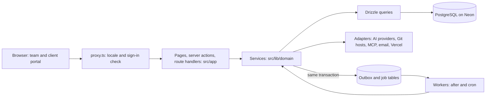

# Saqina Dev

One workspace for client projects: scope, agreements, invoices, payments, development and
maintenance, with an AI assistant that answers from the whole project record and a portal where the
client follows progress. Live at [saqina.dev](https://saqina.dev). Built by Abati Technology.

## How it uses Claude

- **Assistant and intent detection**: read-only answers and intent detection run on Claude through the
  Anthropic adapter (`src/lib/ai/adapters/anthropic.ts`). Actions that change data stay
  rule-validated; a model never writes, merges or deploys on its own.
- **Project brain**: every change is written to an outbox and distilled into memory and PRD findings,
  so Claude reads a project delta instead of rescanning it ([ADR 0003](docs/adr/0003-project-brain.md)).
- **MCP tools and agents**: Claude clients can read a project and append memory inside the permission
  they were granted; every call is audited.
- **Safe by default**: without `ANTHROPIC_API_KEY` Saqina answers from deterministic rules and no data
  leaves the server. Customer documents go to a model only with recorded consent.
- **Built with Claude Code**: AI-written code is attributed per pull request and Red-lane paths get a
  human and an adversarial review ([governance](docs/standards/governance.md)).

## Stack

Next.js 16 (App Router), React 19, TypeScript, PostgreSQL with Drizzle ORM, Better Auth, next-intl
(English and Indonesian), Tailwind CSS 4, Vitest, Biome. Deployed on Vercel with Neon.

## Design theme and landing pages

Full detail: [design and landing pages](docs/design-and-landing.md).

- **Saqina's own look.** A dark scheme with warm graphite surfaces and one coral accent (`#FF6A55`)
  for the main action and focus, set as CSS variables in `src/app/globals.css`. Geist and Geist Mono
  are the fonts. Green, blue, amber and red are kept for status, never decoration.
- **The public landing page** has five sections: hero, a nine-step lifecycle (idea to maintenance),
  three pillars (one project, client portal, Ask Saqina), an interactive demo that reads a project idea in
  the browser with no AI call, and a closing call to action. Text is in English and Indonesian
  (`src/content/site`).
- **21 UI themes** the interview can recommend for a client's project, in five groups (SaaS, minimal,
  media, organic, creative) and three tiers: *recommended*, *available* and *concept*. A concept theme is
  never suggested automatically. The gallery is at `/themes`.
- **18 landing page concepts** in six groups (story, interaction, spatial, system, conversion,
  foundation). A project gets one primary and at most two supporting concepts, chosen by project type
  and always changeable.

## AI orchestrator

Full detail: [AI orchestrator](docs/ai-orchestrator.md).

The orchestration is our own code on PostgreSQL and the Next.js app, with no agent framework or queue
service:

- **Models** are reached through a gateway and one adapter per protocol (Anthropic, OpenAI and
  compatible endpoints, Gemini, Vercel AI Gateway, or a CLI logged in on the server). The gateway
  picks a model per call from the person's choice, the agent's mapping, the project and the platform
  default, and falls back when one fails.
- **Plan and Build** run as an execution: a planner makes a task graph, tasks start when what they
  depend on has succeeded, agents commit to a work branch and review each other, and a person merges.
  State, queue and event log are PostgreSQL tables claimed with `FOR UPDATE SKIP LOCKED`.
- **Worker and realtime**: work after the response (`after()`) plus a cron route, and server-sent events
  read from the stored log. No Redis, BullMQ, WebSockets, LangChain or Vercel AI SDK.
- **Control** stays with people: only the platform Owner manages agents and providers, agents use only
  the tools in their definition, and nothing is merged or deployed by an agent.

## Architecture

Saqina is a **modular monolith**: one Next.js app, one PostgreSQL database, no separate API server,
queue service, worker process or realtime service. Server-first: pages are React Server Components,
and a change goes through a server action that calls one service.



- **Layers.** A page or action parses input and calls one service. The service checks permission
  (it takes an `Actor`, never trusts a hidden button), applies the rules, runs the transaction and
  writes the audit event. Queries only read and write. Components hold presentation and never import
  the database. More than 60 domain folders sit under `src/lib` (documents, billing, executions, memory,
  white-label and so on). See [architecture](docs/standards/architecture.md).
- **Areas.** `src/app/[locale]` has four route groups: the public site, sign-in, the team area
  (`/dashboard`, `/project/[slug]`) and the client portal (`/portal`). `src/app/api` holds webhooks,
  MCP, cron, health and the guide assets. The locale is the root segment (English and Indonesian);
  a server action receives it as an argument because `next/root-params` does not work there.
- **Tenancy.** Everything belongs to an organization and a project. A person who is not a member
  gets NOT_FOUND, never "forbidden", so a project's existence is not revealed.
- **Outside systems sit behind adapters** (`AiProvider`, `GitAdapter`, MCP, email), so tests use fakes
  of the same interface and a new provider is a new registry entry.
- **Background work needs no extra infrastructure.** A change writes an outbox row in the same
  transaction ([ADR 0003](docs/adr/0003-project-brain.md)); jobs are rows claimed with
  `FOR UPDATE SKIP LOCKED` and run after the response and by Vercel cron
  ([ADR 0020](docs/adr/0020-execution-engine.md)). Live progress in the Studio is server-sent events
  read from the stored event log, so a reload or a dropped connection loses nothing.
- **AI never acts alone.** Models plan and answer; every write is checked by rules and a person
  approves it. A model is reached through a gateway with a control plane for the platform owner, or
  through a CLI logged in on the server ([ADR 0023](docs/adr/0023-local-cli-provider.md)).
- **Memory is governed data.** Project memory has an owner, visibility, versions and sources, and
  access is checked before search ([ADR 0004](docs/adr/0004-project-memory.md)).

The decisions behind this live in [docs/adr](docs/adr/), numbered 0001 to 0024.

## Prerequisites

- Node.js 24 LTS and pnpm 10
- PostgreSQL 14+, plus a second database whose name contains `_test` for tests. Use a **local**
  database in `.env.local`: `DATABASE_URL` must not point at production (Neon), because `pnpm dev`,
  `pnpm db:*` and the seed all write to it
- PostgreSQL 14+ with the `vector` extension available (pgvector), which the migrations create

## Local setup

Full walkthrough, including the agent Studio and deployment: [docs/installation.md](docs/installation.md).

```bash
pnpm install
```

```bash
cp .env.example .env.local
```

Fill in `.env.local`. Every variable is documented in [`.env.example`](.env.example); the required
ones are `DATABASE_URL`, `BETTER_AUTH_SECRET` and `SAQINA_ENCRYPTION_KEY`. `ANTHROPIC_API_KEY` is
optional.

```bash
pnpm db:migrate
```

```bash
pnpm db:create-owner
```

```bash
pnpm dev
```

## Scripts

| Script | Purpose |
|---|---|
| `pnpm dev` / `pnpm build` / `pnpm start` | Run, build, serve |
| `pnpm lint` | Biome check |
| `pnpm typecheck` | Next typegen and `tsc --noEmit` |
| `pnpm test` / `pnpm test:coverage` | Vitest (integration tests need `DATABASE_URL_TEST`) |
| `pnpm e2e` | Playwright end-to-end test of the Studio (needs `DATABASE_URL_E2E`; not in CI yet) |
| `pnpm check:licenses` / `pnpm check:coverage` | Licence and coverage gates used in CI |
| `pnpm db:generate` / `db:migrate` / `db:seed` | Schema migrations and seed data (local database only) |
| `pnpm db:migrate:neon` | Apply migrations to Neon with `neonctl`; asks to confirm, `--backup` snapshots first, `--dry-run` shows the plan |
| `pnpm smoke <url>` | Post-deploy smoke test |

## Documentation

- [Product requirements (PRD)](docs/PRD.md): users, goals, requirements with status
- [Engineering standards](docs/standards/README.md): architecture, security, testing, delivery,
  observability, compliance, governance
- [Installation guide](docs/installation.md): local setup, agents, deploy
- [Design and landing pages](docs/design-and-landing.md): Saqina's theme, the 21 UI themes, the 18 landing concepts
- [AI orchestrator](docs/ai-orchestrator.md): models, agents, executions and what they run on
- [Runbook](docs/runbook.md): deploy, migrate, roll back, incidents
- [Architecture decisions](docs/adr/), including [imported projects follow GitHub](docs/adr/0005-imported-projects-follow-github.md) and
  [two-party document signing](docs/adr/0006-two-party-document-signing.md)
- User guides, signed-in only and written per reader: the team at `/dashboard/docs`, clients at `/portal/docs`.
  Pages are Markdown in `src/content/docs/<owner|client>/<en|id>/` and their screenshots in
  `src/content/docs/assets/<owner|client>/`, served only to people allowed to read that guide
- White label ([standard](docs/standards/white-label.md)): what a client portal may brand and what it never hides
- Proposals, agreements, handovers and maintenance agreements are drafted from project data, edited,
  approved, signed by the team and the client, and only then issued with a reference number
- Importing from GitHub: documents are read from the repository (one way, the most recent edit wins),
  everything in the docs folder is shown to the client, and the PRD is found by name or asked for
- Project memory ([ADR 0004](docs/adr/0004-project-memory.md)): chat and agent suggestions wait for review, access is
  checked before search, retrieval is full-text and exact match (also by meaning for a project that opted in, [ADR 0024](docs/adr/0024-semantic-search.md); the UI says on, off or degraded)
