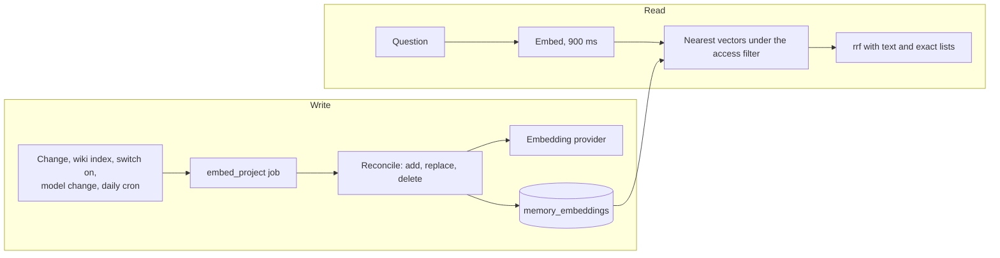

# 24. Semantic search: one vector per eligible text, kept by a reconcile job, searched exactly per project

Status: accepted (2026-11-05). Risk lane: Red (migration, provider credentials, project text sent to a provider).

## Context

Retrieval ([ADR 0004](0004-project-memory.md)) was full-text plus exact match, and the UI said
"Semantic search: off". A question in other words than the memory ("who pays for hosting" against "the
client covers the Vercel bill") found nothing. Closing that gap sends project text to an embedding
provider, so it needs consent, an owner-controlled provider, and a search that never widens who can
read what. Saqina runs on Vercel functions and Neon PostgreSQL, with no worker process.

## Decision

- **A table of vectors, separate from the source tables.** `memory_embeddings` holds one row per
  (source, model): `asset_id` or `chunk_id` (exactly one is set, both cascade on delete), `model_id`,
  `content_hash`, `embedding vector(1536)`. Unique on (`asset_id`, `model_id`) and on (`chunk_id`,
  `model_id`). Every provider is asked for 1536 numbers, so a model with another native size still fits.
  Migration 0039 is expand-only and runs `CREATE EXTENSION IF NOT EXISTS vector`.
- **Exact search per project, no vector index.** A query takes the nearest vectors of one project and
  one model by cosine distance. One project holds hundreds to a few thousand rows, so a scan is fast.
  HNSW is deferred until a single project passes tens of thousands of rows.
- **One reconcile job per project (`embed_project`) keeps the vectors right.** It lists what may be
  embedded now, deletes vectors of another model or of a source that is no longer eligible, embeds what
  is missing or whose text hash changed (64 texts per provider call, 256 per run; a follow-up job
  finishes a larger project), and upserts. A second run with nothing changed calls no provider. Before
  each provider call it reads the project switch and the eligibility of the batch again, and before
  each write it does so once more inside the transaction, under share locks. At most one waiting job exists per project.
- **Triggers.** The outbox consumer (`processProjectChanges`), the end of the `index_wiki` job, turning
  the switch on, changing the embedding model (queues every project that opted in), and the daily
  maintenance cron as a safety net (requeues opted-in projects and deletes the vectors of projects
  that are not opted in, `sweepDisabledEmbeddings`).
- **Eligible:** the project opted in, the asset is `approved`, its visibility is `project`, it has not
  expired, and for wiki passages the source is `ready`. `private`, `restricted` and `agent` assets are
  never embedded, which is stricter than "not private". One text is cut at 6000 characters (in SQL, so
  the full text does not leave the database).
- **Opt-in per project, off by default.** Turning it on needs `members:manage` and the current consent
  version (`CONSENT_VERSION`, recorded in the audit event `memory.semantic_enabled` with the actor).
  Turning it off writes `memory.semantic_disabled` and deletes the project's vectors in the same
  transaction. The switch is on the Memory overview.
- **Provider path.** An `embedding` operation in the AI gateway: the OpenAI adapter (which also serves
  compatible endpoints) and the Gemini adapter implement `embed`. Anthropic has no embedding API. The
  Owner picks one model in AI & Models; only a model with the `embeddings` capability is offered.
  `embedderAllowed` is the single rule, used when the model is chosen and again on every call: not a
  person-owned gateway, the provider is usable, and the Owner's provider policy
  (`allowExternalProviders` and the allow-lists) permits it. There is no fallback to another model,
  because vectors of two models cannot be compared. Each call writes an `ai_usage_records` row with
  operation `embedding`, the token count and the duration, never the text.
- **Read path.** The question is embedded while the text lists run, limited to 900 ms or 60% of the
  retrieval budget, whichever is less, so a provider that hangs costs the vector list only. The nearest vectors with cosine
  distance below `MAX_COSINE_DISTANCE` (0.6), at most 30 per list, are taken under the same access
  filter as the text lists (`visibleWhere`, status, expiry), so access is checked before ranking. The
  vector list is fused with the full-text and exact-match lists by `rrf()`. Retrieval reports
  `semantic`: `on`, `off` (not opted in or no model) or `degraded` (the embedding call failed or timed
  out; the answer is lexical). `indexing` appears only on the Memory overview, as "indexed of
  eligible". A failure never fails retrieval and never falls back to another project's data.

## Alternatives

- **Vector columns on `memories` and `wiki_chunks`:** swapping or switching off a model would rewrite hot
  tables. A separate table is emptied in one statement.
- **An external vector database:** a second source of truth with its own copy of the access rules.
- **HNSW now:** an approximate index loses recall under a filter as strict as project, model and
  visibility. Not worth it at this size.
- **One job per source:** every write path would need its own hook. One reconcile per project reads the
  current state, so a missed trigger only delays recall.

## Consequences

- Each search with semantic search on makes one embedding call. It is limited to 900 ms; when it fails
  or times out the answer is lexical and says `degraded`. It costs provider tokens (counted in usage).
- A late reconcile only delays recall. It never widens access, because retrieval re-checks visibility,
  status and expiry on every query.
- A vector can exist briefly for an asset made private right after a write: the share lock makes the
  write wait for the change, but the next reconcile (or the daily cron) removes what slipped through.
  Retrieval hides it meanwhile, because the access filter applies to the source row.
- Consent withdrawn or an item made private while a run is in progress: immediately before each
  provider call the job re-reads the switch and the eligibility of the batch, stops sending when
  consent is off (no follow-up job is queued) and drops items that are no longer eligible; the write
  checks again. A narrow window remains: an item can change between that check and the moment the
  request leaves the server, and text already sent cannot be recalled if consent is withdrawn while a
  request is in flight. In both cases nothing is stored. So private items are not embedded, but one made
  private during a run can, in that window, still be sent in that run.
- The daily cron is the safety net; on Vercel Hobby it is the only scheduled trigger, so a failed job
  that nothing else requeues waits up to a day.
- A model change re-embeds every opted-in project; until a project finishes, search is partly lexical.
  Vectors of the old model are deleted, not kept.
- `MAX_COSINE_DISTANCE` is a guess made with the test embedder. Tune it with the real model on real
  memories before release.
- The consent wording (English and Indonesian) needs the owner's review before release.
- The consent dialog names the provider the text goes to (the provider's name as the owner entered
  it); consent version `2026-11-05`. Accepted decision: if the platform owner later switches the
  embedding model to another provider, enabled projects are not asked again; their text goes to the
  new provider. The owner is accountable for that choice, and a provider change shows in the audit
  trail of the model save.
- The migration needs the `vector` extension on Neon (the runbook has the check).
- Embedding calls are limited to 120 a minute per project, shared by questions and background runs.
- Choosing "None" as the embedding model deletes the vectors of every opted-in project on its next
  reconcile (queued by the save).
- Known gaps from review: the stored embedding
  model that is no longer usable shows as "None" in AI & Models and Save clears it silently; the
  enqueue guard is not atomic (two jobs can queue at once, which only costs one extra run).
