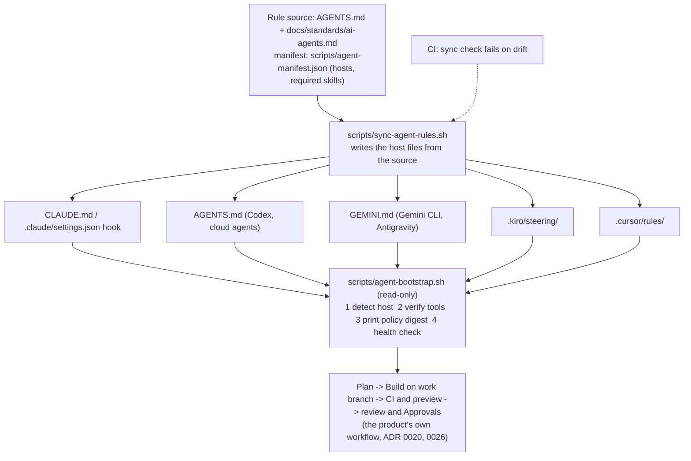

# 27. One bootstrap check and one rule source for every agent host

Status: proposed (2026-11-10). Risk lane: Green (developer tooling and docs, no product code, no migration).
Nothing in this page is built yet. It needs a yes before any script or hook is written.

## Context

Several agent hosts work in this repository: Claude Code, Codex, Gemini CLI, Antigravity, Kiro and Cursor,
plus agents a person connects over MCP ([ADR 0014](0014-local-ide-sync-over-mcp.md)). Today:

- The workflow rule (Superpowers, Ruflo, antislop; [ai-agents.md](../standards/ai-agents.md)) is copied by hand
  into `AGENTS.md`, `GEMINI.md` and `.kiro/steering/prd-plan-workflow.md`. The copies can drift and nothing
  fails when they do.
- `scripts/check-agent-skills.sh` reports missing skills, but a person has to remember to run it. In some
  sessions Superpowers and Ruflo were simply not installed and the agent found out late.
- Cursor has no rules file here, and a cloud agent has no setup step beyond what its environment holds.
- Code-graph reads exist inside the product (`find_symbol`, `find_callers`, `file_impact`) but not for an
  agent that edits this repository.

An outside diagram, "Global Agent Bootstrap Architecture", names the shape: a control plane, a session
bootstrap, host adapters, then Superpowers, Ruflo and Graphify under a verified workflow. This page decides
how much of it fits this project.

## Decision

1. **One rule source.** `AGENTS.md` and `docs/standards/ai-agents.md` stay the source. A small manifest
   (`scripts/agent-manifest.json`) lists the hosts, the file each one reads and the required skills. This is
   the "control plane": a file in git, reviewed in a pull request, not a service.
2. **Generated host adapters.** `scripts/sync-agent-rules.sh` writes the host files (`GEMINI.md`,
   `.kiro/steering/prd-plan-workflow.md`, new `.cursor/rules/prd-plan-workflow.mdc`) from the source. A
   `--check` mode runs in CI and fails when a file differs. Status moves from Manual to **Enforced**.
3. **Bootstrap script, read-only.** `scripts/agent-bootstrap.sh` does four things and changes nothing:
   it detects the host from its environment and folders; verifies the required skills (reusing
   `check-agent-skills.sh`); prints a short digest of the policy (files and the hash of `AGENTS.md`); and
   runs a health check (Node and pnpm versions, git state and branch, `DATABASE_URL_TEST` set, Postgres
   reachable). It exits non-zero on a gap and prints the fix for each.
4. **Who runs it.** Claude Code runs it from a `SessionStart` hook in `.claude/settings.json`: **Enforced**.
   The other hosts have no such hook, so their rules file starts with "run `bash scripts/agent-bootstrap.sh`
   first": **Manual**, and the page says so. A cloud agent runs it in its environment setup script.
5. **Graphify is not adopted.** The product's code-graph tools already cover the role for agents inside
   Saqina. For a host editing this repository, the bootstrap only reports whether a code-graph tool is
   available. Adding Graphify is a separate decision with its own ADR if the report shows a real gap.
6. **Ruflo stays external.** It is a memory and planning tool the person installs; the bootstrap checks for
   it and never installs it. Missing Ruflo or Superpowers stops the PRD and plan workflow, as the rule says
   today. It does not stop other work.

## Consequences

- Rule drift between hosts fails in CI instead of surfacing in a review.
- A missing skill shows up at session start in Claude Code, not halfway through a plan.
- Only Claude Code gets an automatic run. Five hosts rely on a person or the agent following one line.
- The sync script is one more thing to maintain, and a host that changes its rules file location needs a
  manifest edit.
- Nothing here runs agents or touches client data. The bootstrap reads local state only and prints no
  secrets, only whether a variable is set.

## Out of scope

- A hosted control plane, a policy service or remote configuration of developers' machines.
- Installing Superpowers, Ruflo or Graphify for the person.
- Changing the product's own execution engine ([ADR 0020](0020-execution-engine.md)).

## Open questions

- Is a Cursor rules file wanted, or does the team not use Cursor on this repository?
- Should the CI check also run `check-agent-skills.sh`? It would fail on any runner without the skills, so
  the proposal runs only the drift check in CI.

## Work to do after a yes

1. Manifest and `sync-agent-rules.sh` with `--check`, tests for both, CI step.
2. `agent-bootstrap.sh` and the `SessionStart` hook, tests with a fake home folder.
3. Update `docs/standards/ai-agents.md` (status Manual to Enforced for drift, the bootstrap section) and
   `docs/runbook.md`. The PRD gets no row: this is developer tooling, not a product feature.
