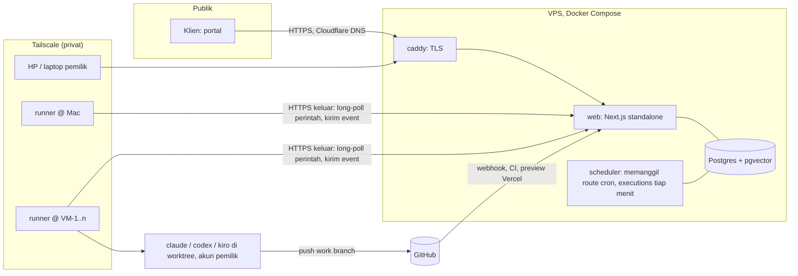

# Agent harness: Saqina mengendalikan agent coding di mesin sendiri

Tanggal: 2026-11-10
Status: rancangan, menunggu review pemilik. Belum ada kode.
Risk lane: Red (infrastruktur, eksekusi shell di mesin pemilik, token perangkat, migrasi).
Keputusan terkait: [ADR 0028](../../adr/0028-host-on-a-vps-with-docker.md) (hosting),
[ADR 0029](../../adr/0029-agent-harness-with-runners.md) (harness dan runner).

## Keputusan pemilik (2026-11-10)

1. Saqina dipakai pribadi: satu operator, yaitu pemilik. Klien tetap memakai portal seperti sekarang
   (invoice, request fitur, preview plan) dan tidak pernah melihat harness.
2. Pemilik sering pindah model dan perangkat dan punya beberapa VM. Ia ingin mengendalikan sesi agent di
   semua mesin itu dari satu layar, seperti contoh ZEVN/OS.
3. Hosting pindah dari Vercel Hobby ke VPS dengan Docker, di Instabox. Database sekarang di Neon.
6. Repo klien kemungkinan besar dikerjakan di VM terpisah dari repo pribadi.
7. Untuk akun langganan, sisa kuota wajib tampil seperti di contoh ZEVN/OS.
4. Orchestrator tetap milik Saqina. Tidak memakai LangChain atau LangGraph.
5. Ruflo (`sparc-spec`, `goal-plan`) tidak terpasang di sesi ini; langkahnya diikuti manual atas izin
   pemilik.

## Masalah

- Agent Saqina sekarang hanya mengembalikan edit file lewat API model. Mereka tidak bisa menjalankan
  build atau tes, jadi kegagalan baru terlihat saat Vercel atau CI membangun ([ADR 0026](../../adr/0026-repair-failed-builds.md)).
- Di Vercel Hobby, cron hanya boleh harian dan `after()` terbatas, sehingga pekerjaan agent yang terputus
  menunggu sampai sehari (PRD E12).
- Langganan Claude dan ChatGPT milik pemilik hanya aman dipakai lewat CLI resmi di mesinnya sendiri. Saqina
  di server tidak boleh memakainya ([ADR 0023](../../adr/0023-local-cli-provider.md)).
- Sesi Claude Code di Mac dan beberapa VM tidak terlihat dari satu tempat, dan tidak bisa dilanjutkan dari
  HP.

## Lingkup

- Hosting Saqina di VPS: web, worker yang hidup terus, Postgres, backup.
- `saqina-runner`: program kecil di Mac dan VM yang menjalankan CLI resmi (Claude Code dulu, lalu Codex dan
  Kiro) di git worktree, dan melapor ke Saqina.
- Cockpit khusus Owner: daftar mesin, daftar sesi lintas mesin, satu sesi dengan chat, langkah, file yang
  berubah, diff, stop, pesan antre, mode izin, model, akun.
- Executor `runner` di orchestrator, di samping executor model yang ada.
- Sesi terikat ke proyek Saqina, sehingga hasilnya muncul di task, Code, Preview dan portal klien.

## Bukan lingkup

- Terminal di browser (tab TERM). Pakai SSH lewat Tailscale.
- Menjalankan CLI atau kode agent di server Saqina.
- Menyimpan, menyalin atau memakai token OAuth langganan di Saqina.
- Animasi "Town" dan dekorasi lain di contoh.
- Fitur multi-tenant baru (white-label, paket). Fitur yang ada tidak dihapus.

## Arsitektur

### 1. Hosting (ADR 0028)

- Docker Compose dengan layanan `web`, `scheduler`, `postgres` (dengan pgvector) dan `caddy`.
- `scheduler` adalah loop Node tanpa dependensi, dari image yang sama, yang memanggil route cron yang sudah
  ada dengan `CRON_SECRET`: executions tiap menit; reminders, maintenance dan doc-sync pada jam yang sama
  dengan `vercel.json`. Satu job tidak pernah jalan dua kali bersamaan. `after()` tetap jalur cepat, dan
  karena proses `web` hidup terus, drain dari `after()` tidak terpotong.
- Backup `pg_dump` tiap malam ke object storage (R2 atau S3), dengan uji restore tercatat di runbook.
- **Database pindah dari Neon ke Postgres di VPS.** Alasannya:
  - Worker yang mengecek antrean tiap menit dan heartbeat runner tiap 30 detik membuat compute Neon tidak
    pernah tidur, jadi jam compute terpakai penuh.
  - `LISTEN/NOTIFY` untuk long-poll butuh koneksi langsung, tidak lewat pooler.
  - Jarak VPS ke DB menjadi nol. Waktu round trip ke DB jauh adalah penyebab halaman lambat yang diukur
    pada 2026-11-05.

  Caranya: `pg_dump` dari Neon, restore ke VPS, uji, lalu ganti `DATABASE_URL`. Neon dibiarkan hidup dua
  minggu sebagai jalan mundur, baru dihentikan. Yang hilang adalah PITR dan branching Neon; backup malam
  dan uji restore menggantikannya.
- Cloudflare hanya untuk DNS dan proxy domain publik. Aturan cache publik yang sudah ada tetap berlaku.
- `hostedServer()` berganti dari cek `VERCEL` ke flag eksplisit `SAQINA_HOSTED=1`, supaya provider CLI
  lokal tetap tertolak di server.

### 2. Runner

- Satu file yang dipasang sebagai service (systemd di Linux, launchd di macOS).
- **Pairing:** pemilik membuat kode sekali pakai (berlaku 10 menit) di halaman Machines. Runner
  menukarnya dengan token perangkat. Saqina hanya menyimpan hash token. Token bisa dicabut, dan setelah
  dicabut runner berhenti menerima perintah.
- **Koneksi:** hanya keluar, lewat HTTPS ke alamat Tailscale VPS. Perintah diambil dengan long-poll
  (`GET /api/runner/commands`, dibangunkan `LISTEN/NOTIFY` Postgres). Event dikirim dalam batch
  (`POST /api/runner/events`) dengan nomor urut, sehingga pengiriman ulang tidak menggandakan event.
  WebSocket tidak dipakai di v1 karena route handler Next tidak menanganinya. Proses gateway terpisah bisa
  ditambah kalau long-poll terbukti kurang.
- **Inventaris** pada setiap heartbeat (30 detik): versi runner, OS, disk kosong, CLI yang terpasang dan
  versinya, akun yang login (hanya label dan tipe paket kalau CLI menyebutnya), root repo yang diizinkan.
- **Grup mesin:** tiap mesin punya grup, `personal` atau `clients`, ditambah label bebas. Proyek yang
  punya klien hanya dikerjakan di mesin grup `clients`. Proyek pribadi hanya di grup `personal`. Owner bisa
  mengganti grup tujuan per proyek. Repo klien tidak pernah berada di mesin yang sama dengan repo
  pribadi, kecuali Owner sengaja mengaturnya.
- **Akun:** tiap akun CLI punya folder konfigurasinya sendiri di mesin. Runner memilih folder lewat
  variabel lingkungan CLI (untuk Claude Code, `CLAUDE_CONFIG_DIR`; diverifikasi di fase 2). Saqina hanya
  tahu label akun.
- **Sesi:** runner membuat git worktree per sesi di bawah root repo yang diizinkan, lalu menjalankan CLI
  dalam mode headless dengan output stream JSON, model dan mode izin yang diminta. Session id CLI disimpan
  untuk dilanjutkan (`--resume`). Flag tepatnya diverifikasi di fase 3 pada versi CLI yang terpasang.
- **Batas di mesin:**
  - Runner menolak repo di luar root yang diizinkan.
  - Runner memasang hook `pre-push` di worktree yang menolak push selain ke branch sesi.
  - Branch protection di GitHub pada branch utama adalah jaminan sebenarnya. Runbook mewajibkannya.
- Rahasia dan `.env` tetap di mesin. Event yang dikirim disaring dengan `scrubSecrets` di runner dan
  sekali lagi di server.

### 3. Sesi harness

- Sesi selalu milik satu mesin, satu repo, satu worktree dan satu CLI. Statusnya: `starting`, `working`,
  `needs_you` (menunggu izin atau jawaban), `idle`, `stopping`, `ended`, `failed`, `lost` (mesin hilang
  lebih dari 5 menit).
- Pesan yang dikirim saat agent bekerja masuk antrean dan diberikan pada giliran berikutnya.
- **Stop:** perintah stop ke runner, yang mengirim sinyal ke proses CLI. Statusnya `stopping` sampai
  runner melapor.
- **Ganti model** dalam CLI yang sama: berlaku di giliran berikutnya.
- **Ganti CLI** (Claude ke Codex): membuat sesi baru di branch yang sama dengan ringkasan, daftar file yang
  berubah dan potongan transkrip. UI menyebutnya sebagai sesi baru.
- **Pindah perangkat:** transkrip dan event ada di Postgres, jadi sesi dibuka dari perangkat mana pun.

### Kuota langganan (wajib untuk akun langganan)

- **Claude Code** (diperiksa pada versi 2.1.322 di sandbox ini): output `stream-json` mengirim event
  `rate_limit_event` berisi `rate_limit_info`. Isinya status (`allowed`, `allowed_warning`, `rejected`),
  `resetsAt`, `rateLimitType`, dan `unifiedWindows.five_hour` serta `unifiedWindows.seven_day`, masing-masing
  dengan `utilization` dan `resetsAt`. Runner meneruskannya apa adanya.
- Field `unifiedWindows` ditandai internal di CLI, jadi bisa berubah tanpa pemberitahuan. Runner menyimpan
  versi CLI bersama setiap angka. Uji kontrak dengan rekaman output nyata gagal kalau bentuknya berubah.
- Kuota hanya datang selama sesi berjalan. Cockpit menampilkan angka terakhir beserta waktunya ("94% sisa,
  12 menit lalu"). Saat akun idle, runner boleh menjalankan sesi probe kecil sesuai jadwal Owner. Probe ini
  mati secara default karena memakai kuota sendiri.
- **Tidak dipakai:** endpoint usage berbasis token OAuth yang dipanggil CLI secara internal. Endpoint itu
  butuh token langganan dibaca dari mesin, dan ADR 0023 serta 0029 melarangnya.
- **Codex:** output JSON-nya diharapkan membawa batas pemakaian 5 jam dan mingguan. Ini diverifikasi di
  fase 5 pada versi yang terpasang.
- **Kiro:** belum diketahui apakah melaporkan kuota. Diverifikasi di fase 5.
- Kalau sebuah CLI terbukti tidak melaporkan kuota, akunnya tetap bisa dipakai, tapi kartu akun menulis
  "Kuota tidak dilaporkan oleh CLI ini" dengan warna peringatan. Saqina tidak menebak angka.
- Akun dengan status `rejected` atau sisa kuota di bawah batas yang diatur Owner (bawaan 5%) tidak dipilih
  dispatcher sampai `resetsAt` lewat.

### 4. Executor `runner` di orchestrator

- Executor baru yang memenuhi `TaskExecutor` (`src/lib/executions/task-executor.ts`), di samping
  `modelTaskExecutor`.
- Definisi agent mendapat field `executor`: `model` (bawaan) atau `runner`, ditambah preferensi CLI, model
  dan mesin. Versi definisi dan audit tetap seperti [ADR 0022](../../adr/0022-owner-agent-registry.md).
- **Pemilihan mesin:** mesin online, grupnya cocok dengan proyek, punya CLI yang diminta, akun belum
  melapor kuota habis, dan repo proyek ada di root yang diizinkan. Di antara akun yang cocok, yang sisa
  kuota 5 jamnya paling besar dipilih lebih dulu. Kalau tidak ada yang cocok, coba akun atau model cadangan dari
  definisi. Kalau tetap tidak ada, task `blocked` dengan alasan.
- Executor membuat sesi dengan kunci idempoten `run:<runId>:<attempt>` lalu menunggu. Worker memperpanjang
  `lockedUntil` job selama sesi mengirim heartbeat. Kalau worker mati, job diambil lagi dan executor
  **menyambung ke sesi yang sama** lewat kunci itu, bukan membuat sesi baru.
- **Aturan sukses tetap:** task sukses hanya kalau commit di work branch eksekusi terlihat di GitHub
  (dicek ke host, bukan dari laporan runner). Hasil build dan tes yang dijalankan CLI disimpan sebagai
  artefak `test_result` dengan label "dilaporkan runner", terpisah dari CI.
- Prompt task (instruksi definisi, kriteria, input dependensi sebagai data) dikirim sebagai pesan pertama
  sesi. Aturan segmen prompt [E11] tetap berlaku.

### 5. Cockpit (khusus Owner)

- `/dashboard/harness`: daftar sesi lintas mesin dengan filter Needs you, Working, Unread, Closed,
  pengelompokan per proyek, dan pencarian.
- Satu sesi: chat dan langkah (dilipat jadi "Bekerja 3m 12s · 21 langkah · 3 file"), panel kanan berisi
  mesin, CLI, model, akun, kuota (hanya kalau dilaporkan), file yang berubah, Lihat diff, Stop, Tutup.
- `/dashboard/machines`: status, inventaris, pairing, cabut token.
- Live lewat SSE yang sama polanya dengan execution (`seq`, resume setelah putus).
- Notifikasi web push ke HP untuk `needs_you`, `failed` dan `ended`. Ini fase 4 dan butuh kunci VAPID.
- Bahasa Inggris dan Indonesia, 320/768/1280 px, keyboard, dan state loading, kosong dan error.

## Data (migrasi 0042, hanya menambah)

| Tabel | Isi |
|---|---|
| `machines` | id, nama, os, grup (`personal`, `clients`), label, `tokenHash`, `pairedAt`, `revokedAt`, `lastSeenAt`, `inventory` jsonb, `allowedRoots` |
| `machine_pairings` | hash kode, kedaluwarsa, dipakai kapan |
| `cli_accounts` | mesin, CLI, label, status terakhir, kuota 5 jam dan mingguan (`utilization`, `resetsAt`), versi CLI yang melapor, `quotaReportedAt`. Tanpa token |
| `harness_sessions` | mesin, proyek (opsional), repo, branch, worktree, CLI, model, akun, mode izin, status, `cliSessionId`, `idempotencyKey` unik, `executionId` dan `runId` (opsional), biaya yang dilaporkan, `seq` |
| `harness_events` | sesi, `seq` unik per sesi, tipe, payload (sudah disaring), waktu |
| `harness_inputs` | pesan antre: sesi, isi, status (`queued`, `delivered`) |

Ditambah kolom `executor` dan `runnerPrefs` pada `agent_definitions`, dan `runnerGroup` pada `projects`
(bawaan: `clients` kalau proyek punya klien, `personal` kalau tidak). Indeks: `(machineId, status)`,
`(projectId, updatedAt)`, `(sessionId, seq)`.

## Keamanan

| Ancaman | Penangkal |
|---|---|
| Token runner bocor | Hanya hash di DB, satu token per mesin, bisa dicabut, terikat ke alamat Tailscale, rate limit |
| Perintah dari orang lain | Semua route harness dan runner hanya untuk Owner platform. Orang lain mendapat NOT_FOUND (dites) |
| Agent mendorong ke main | Hook `pre-push` di worktree dan branch protection di GitHub (wajib, runbook) |
| Isi repo klien menyuruh agent (prompt injection) | Isi repo adalah data. Mode izin bawaan bukan "bypass". Root repo dibatasi. Repo klien hanya di mesin grup `clients` |
| Rahasia masuk transkrip | `scrubSecrets` di runner dan server. Nilai `.env` tidak pernah dikirim |
| Akun langganan diblokir | CLI resmi di mesin pemilik, satu orang, tanpa berbagi akun. Peringatan ADR 0023 tetap tampil |
| VPS mati | Runner menyimpan event di disk dan mengirim ulang. Sesi CLI tetap jalan. Backup DB tiap malam |

## Fase

| Fase | Isi | Selesai bila |
|---|---|---|
| 0 | Spec ini, ADR 0028, ADR 0029, perubahan PRD | Pemilik menyetujui |
| 1 | Compose di Instabox, worker, jadwal tiap menit, backup, `SAQINA_HOSTED`, pindah DB dari Neon, Tailscale, runbook | Saqina jalan di VPS, job eksekusi diambil dalam satu menit, restore backup teruji, Neon tidak lagi dipakai aplikasi |
| 2 | Runner v0: pairing, heartbeat, inventaris, grup mesin, halaman Machines, cabut token | Semua mesin terlihat dari HP dengan grupnya, token yang dicabut ditolak |
| 3 | Sesi Claude Code: mulai, stream, stop, antre, worktree, file dan diff | Satu sesi nyata dari cockpit sampai commit di branch sesi |
| 4 | Cockpit penuh: filter, panel kanan, mode izin, biaya, kuota 5 jam dan mingguan per akun, web push | Alur seperti contoh, di 320/768/1280 px; kuota Claude Code tampil dari event nyata |
| 5 | Codex dan Kiro, ganti model, handover antar CLI | Pindah CLI tanpa kehilangan branch dan konteks |
| 6 | Executor `runner` di orchestrator, sesi terikat proyek, hasil ke task dan portal | Build dari Studio dikerjakan di VM, task sukses dengan commit di GitHub |

## Pengujian

- Integrasi (Postgres asli): pairing, cabut token, NOT_FOUND untuk non-Owner, event idempoten dan urut,
  antrean pesan, transisi status sesi, pemilihan mesin, sambung ulang setelah worker mati.
- Runner: CLI palsu (skrip yang mengeluarkan stream JSON) dan repo git sementara. Tidak ada panggilan model
  sungguhan di CI.
- E2E Playwright: pairing dengan runner palsu, mulai sesi, lihat langkah dan diff, stop.
- Uji manual di fase 3 dan 5 dengan Claude Code, Codex dan Kiro sungguhan. Hasilnya ditulis apa adanya di
  PR.

## Pertanyaan terbuka

- Spesifikasi dan lokasi VPS Instabox: RAM, disk, dukungan Docker, snapshot, dan region. Untuk Postgres,
  web dan worker dibutuhkan minimal 4 GB RAM.
- Region proyek Neon sekarang, untuk memperkirakan waktu pindah dan menguji `pg_dump` lebih dulu.
- Format kuota Codex dan Kiro (fase 5).
