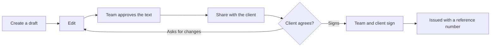

Four documents are drafted from the project records and signed by **two parties**: the **Proposal**, the **Agreement**, the **Handover** and the **Maintenance agreement**. A document is **only issued with a reference number once the team and the client have both signed the same version**. Until then it is a draft you can edit.

## Step 1. Create a draft

Open **Documents** in the project and choose one of the buttons under **Create business document**. The text is drafted from the scope, schedule, milestones, client and value of the project. Parts without data are marked `[PLACEHOLDER]` or `[TERM]` so you complete them. A draft is not legal advice: have it reviewed before it is signed.

## Step 2. Edit

Choose **Edit** to complete the text, then **Save**. Every save is one version. Regenerating the draft from project data also keeps the earlier versions in the history.

Changing the text **removes any signatures** and the document goes back to waiting for approval. That way nobody signs words they did not see.

## Step 3. Approve the text

Under the text there is a panel, **Approval and signatures**, with four steps: text approved by the team, team signature, client signature, and issued with a reference number. Press **Approve** under the text.

## Step 4. Share with the client and sign

Once approved, the panel offers two buttons:

- **Share with the client**: the client can only sign what they can read, so share first.
- **Sign as the team**: the team's signature, recorded with the name and the time. Only a project owner or admin can sign.

After the team signs, the panel shows who and when, and waits for the client.

## Step 5. The client signs, the document is issued

The client opens the document on the portal. They can **sign**, or **ask for changes** with a note. The client guide covers that side.

- **When the client signs**, the document is **issued** at once: its status becomes signed, a reference number is created (for example `AGR-2026-001`), and the document is locked. The order does not matter: team first or client first gives the same result.
- **When the client asks for changes**, the document goes back to review, leaves the portal, and every signature is removed. The team is notified with the client's note. Edit, approve, share and sign again.

## Reference numbers

The format is `CODE-YEAR-SEQUENCE`, with a sequence that runs separately for each kind of document, organization and year:

- Proposal: `PRP-2026-001`
- Agreement: `AGR-2026-001`
- Handover: `HND-2026-001`
- Maintenance agreement: `MNT-2026-001`

A number is only created once both parties have signed. A draft, or a document waiting for signatures, has none.

## Good to know

- An issued document **cannot be edited or regenerated**. For a change, create a new document or archive the old one.
- There is no "mark as signed" button for these four documents: a signature always comes from each party.
- Each signature records the signer's name and a hash of the text that was signed, so it can be matched to its version.
- Other documents (PRD, plan, ordinary documents) keep the ordinary statuses, without two-party signing.
