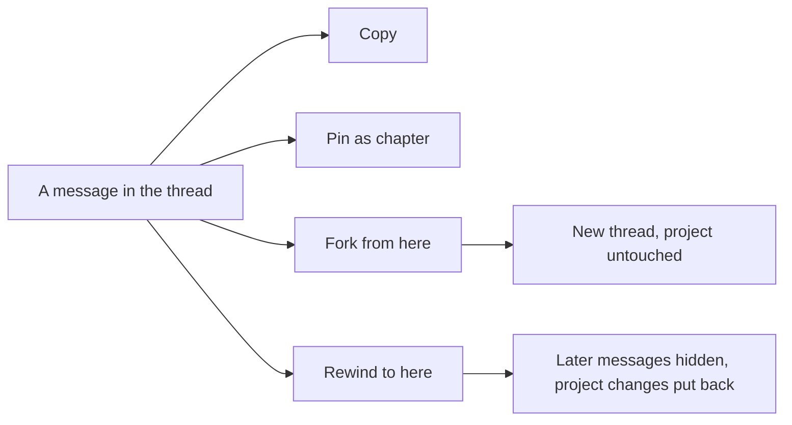

The Saqina chat is where you ask questions and tell the assistant what to change. Every message can be reused, bookmarked, branched or taken back. Threads are **private to you**: no one else on the team sees them.

## Message actions

Point at a message, or tab to it, and a row of icon buttons appears under it; point at or focus an icon to see its name. On a phone the row is always visible. Each message also shows its **time** in your own timezone: the time alone for today, the date and time for other days. Hover the time for the full date and how long ago it was.

- **Copy** (two sheets) puts the message text on your clipboard. The icon turns into a check mark for a moment.
- **Pin as chapter** (bookmark) and **Fork from here** (branch) are described below.
- **Rewind to here** (counter-clockwise arrow) is not offered on the last message, because nothing comes after it. It needs permission to edit the project, so viewers do not see it.

The actions appear only on messages that are saved, so they are hidden while a reply is still being written.

## Pin a message as a chapter

Choose the bookmark, **Pin as chapter**, name it (the first words of the message are suggested) and press **Save**. A bookmark with the name shows next to the message. The **Chapters** list in the chat header jumps straight to it, and loads older messages first when the chapter is far back. The bookmark of a pinned message is filled: choose it again, **Unpin chapter**, to remove the chapter.

## Fork from here

**Fork from here** copies the thread up to and including that message into a **new thread** and opens it. Use it to try another direction without touching the original. A fork starts with the history only: proposals waiting for approval and agent runs stay with the original thread, and nothing in the project changes. The fork shows **Forked from** with a link back.

## Rewind to here

**Rewind to here** takes the thread back to a message **and** puts back what the assistant changed in the project after it. A dialog first shows what would happen: how many messages are hidden, which changes are put back, and any proposals waiting for review, which are cancelled.

What is put back:

| Change the assistant made | When you rewind |
|---|---|
| A task or requirement it created | Removed |
| A task or requirement it changed | Restored to how it was |
| A section it added to the PRD, or a document it rewrote | The previous text comes back as a new version |

Rewind is **all or nothing**. If anything after the message cannot be put back, nothing is changed and the dialog lists what stops it:

- Things that reached other people or systems: invoices, payment schedules, client reminders, agent handoffs, tool runs and agent assignments.
- Records the assistant created that cannot be removed cleanly: memory, decisions, scope items, change requests, generated documents, and deleted tasks.
- A task, requirement or document that **someone edited after** the assistant changed it. Saqina never overwrites your edit.

When rewind is blocked, choose **Fork from here instead**: a fork never touches the project. Messages that were rewound are hidden, not deleted, and the rewind is written to the audit trail.

## See who has read a message

Under your message you see **Read by Saqina** once the assistant has picked it up. When a connected agent reads the thread, **Read by** and the agent's name appear under every message it has received. Messages written after it last read stay unmarked.

## Let connected agents read a thread

Agents connected to the project through MCP cannot see any chat by default. Turn on **Let connected agents read this chat** for one thread to open it. The agent then lists shared threads with `list_conversations` and reads the latest messages with `read_conversation`. It sees only threads you opened, never rewound messages, and each read is recorded so the team can see it. Turn the switch off to close the thread again.

## Good to know

- Pins, forks and rewinds apply to your own threads only.
- A rewind that restores a document can push the older text to GitHub when document sync is on.
- Memory suggestions already taken from a hidden message stay in review. You decide about them as usual.
