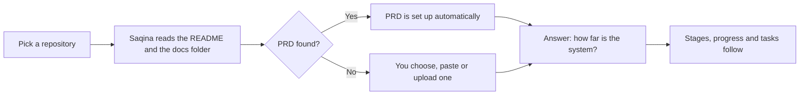

Use the import when your system **already has a GitHub repository**, whether it is live, in review, or still being built. Saqina reads the README and the documentation folder and sets up the workspace, so you do not fill in the interview from scratch. GitHub stays the source of the documents: Saqina only reads, and never writes to your repository.

## Before you start

- The repository name on GitHub, for example `acme/restaurant-pos`, or its URL.
- A **public** repository needs nothing else. A **private** one needs a connected GitHub account, or a read-only access token.
- Documents that clients should read are best kept in one folder, usually `docs`.

## Step 1. Open New project

From the dashboard, choose **New project**. The first page offers two ways to start.

## Step 2. Choose the Import from GitHub tab

The tab explains what Saqina reads. Press **Connect with GitHub** to pick a repository from your account's list, private ones included, without copying a token. You can also type the repository name directly.

## Step 3. Fill in the import options

Below the repository field there are three inputs and one choice.

- **Access token** is only for private repositories. Create a fine-grained token with read access to Contents. It is stored encrypted and connects the repository to the project.
- **Documentation folder** is optional. Leave it empty to use `docs`. Everything in this folder is read (up to 200 files and 6 levels deep), shown in Saqina, and readable by clients. Text that looks like a secret, such as an access key, is imported but never shared with clients.
- **Let AI read the documents** is off by default. When it is off, Saqina uses simple rules and nothing leaves the server.

Press **Import and review**.

While it reads, the button changes to **Reading the repository…**. GitHub limits public repositories without a token to about 60 requests an hour, so do not repeat an import many times in a short while.

## Step 4. Answer: how far is the system?

When the import finishes you land on the **Progress** page. Saqina deliberately does **not** assume the project is only starting to be built, because an imported system may already be live. Answer three questions:

- Has the system finished building?
- Has the system been reviewed?
- Has the system been deployed?

Until you answer, the project overview shows the next step **Say how far the system is**, and the Build, Review and Deploy stages are not lit.

The answers settle each other. Answering **Yes** to deploy means review and build are **Yes** too. Answering **Not yet** to build clears the review and deploy answers that were given.

If the project already has tasks, Saqina offers to bring them in line with your answer:

- build **Yes**: open tasks move to review,
- review **Yes**: every task that is not done becomes done.

You choose **Cancel**, **Answer only**, or **Answer and adjust tasks**. Tasks only move forward and are never reopened, and you can change any task by hand afterwards. If the repository has no task list, no tasks are created.

The stepper on the overview and the next step change too: once build is **Yes**, Review is the active stage.

## Step 5. Set up the PRD

Saqina looks for the PRD across the whole documentation folder, subfolders included. Names such as `prd.md`, `project-prd.md` or `01-prd.md` are recognised. If one is found, the PRD is set up right away and keeps following GitHub.

If none is found, the **PRD** page asks which document is the PRD. There are two ways.

**From the repository.** Pick one of the files already read. It becomes the PRD and keeps following GitHub.

**Paste or upload.** Upload a `.md`, `.markdown` or `.txt` file (200 KB at most), or paste the text. An uploaded file goes into the text box first so you can check it before saving.

An existing PRD is never replaced. If there really is no PRD yet, leave it empty: Saqina does not write a PRD of its own for an imported project.

Every Markdown document supports **Mermaid** diagrams. Write a code block with the language `mermaid` and the diagram shows in the preview and on the client portal. If the diagram text is not valid, its source is shown together with a message.

## Step 6. Check Documents

The **Documents** page lists every file that was read.

- Files in the documentation folder are **Approved** and **Shared**, so clients can read them on the portal.
- Files outside that folder, such as the README, are **Draft** and stay internal. You can share them yourself once you approve them.

## How documents follow GitHub

- **One direction.** Saqina only pulls from GitHub and sends nothing back: no branch, no pull request.
- **When it pulls.** When the Documents page is opened and the last pull is older than 10 minutes, before saving an edit, and once a day by cron.
- **New files** in the documentation folder appear as new documents on their own, and clients can see them.
- **If both sides changed**, the most recent one wins. When GitHub is newer, its text is used and the Saqina text stays in the version history. When the Saqina text is newer, it is kept.
- **The build, review and deploy answers** do not go out of date because of a change from GitHub. If tasks or milestones change after an answer, that answer is marked to be confirmed again.

## Common problems

- **Repository not found.** Check the spelling `owner/name`. For a private repository, connect GitHub or add a token.
- **GitHub is limiting requests.** Wait a few minutes, or connect your GitHub account for a higher limit.
- **The PRD was not detected.** Use the PRD question card on the PRD page to choose, paste or upload one.
- **A document does not show for the client.** Only Approved documents can be shared, and only files in the documentation folder are shared automatically.
- **Your documentation folder is not called `docs`.** Type its name in step 3, for example `documentation/product`.
