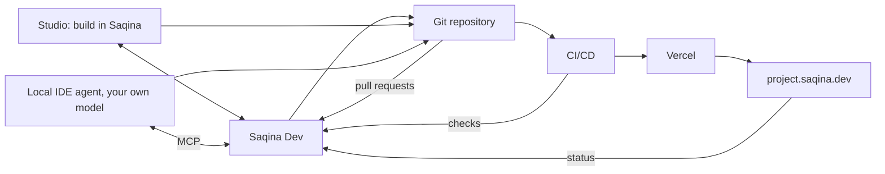

This guide covers the path from an agreed PRD to work in progress, and the platform settings that the assistant and agents use in every project.

## Generate a PRD

On **PRD**, press **Generate PRD**. The form has one field per section, filled from the current PRD or, when there is none yet, from the project interview.

- **Enhance** makes one section more specific. With an AI model set up, the model rewrites it following the Superpowers *brainstorming* skill; without one, Saqina tidies the text by rules and adds nothing new.
- **Enhance all sections** goes through them one by one.
- **Save as PRD** writes a new version. Signatures are cleared and the PRD goes back to draft, so it is approved again before agents work from it.

After the interview, when a model is set up, Saqina also refines the generated PRD and plan with the Superpowers skills and names the project from its plan. The refined documents wait in **Approvals**; nothing changes until you approve. A name you typed yourself is never replaced.

## Start building

Once the PRD or the plan is **approved**, or an agreement is signed by both parties, the document shows **Start building**.

- When the project is built in Saqina, every open task goes to the team agent whose role fits it, and the agents start. Each result is a proposal in **Approvals**.
- When the project is built elsewhere, the button only opens the Studio.

Pressing it again does not give a task to two agents.

## The Studio

The Studio puts the chat beside a work area.

- **Plan** shows milestones and tasks. When you ask for a plan in the chat, the work area turns to it.
- **Agents** shows the agents at work and links to each run.
- **Code** shows the repository (read only), **Git** its pull requests and checks, **Preview** the live site and **Publish** puts it online.

When the assistant is not sure what a change-making request meant, it asks in the chat first and does nothing until you answer **Yes, go ahead**.

## Files and context in the chat

In the Studio chat (and the Saqina page):

- **Attach** (the paper clip) adds files: images, PDF, or text files such as Markdown, CSV or code, up to 5 MB and 5 files per message. You can also drag them onto the chat or paste an image. Text files are read into the conversation; images and PDF are read only when the project's AI model can see them, otherwise the reply says so.
- **+ Context** picks skills and connectors for the next messages. A picked skill always guides the answer. With a connector picked, Saqina uses its tools to answer, and shows what the tool returned. A tool that can change something outside Saqina waits for your approval first.
- **Manage connectors** in the same menu opens the connector settings, for platform owners and project admins.

Files are kept in private storage and open only for members of the project.

## Skills and connectors (platform owner)

Under **AI & Models**:

- **Skills**: working methods in SKILL.md format used in every project. Superpowers is built in. Install more by pasting a SKILL.md or linking to one on GitHub, and choose where each is used. Saqina only reads a skill's text; it never runs anything from it.
- **Connectors**: MCP servers connected once for every project. Firecrawl, Exa and Context7 are one click plus an API key; any other server can be added as a custom MCP. Tools that say they change nothing start switched on; the rest wait for you. Keys are stored encrypted and never shown again.

## Databases and sign-in for your app

In the Studio under **Publish**, add the database or sign-in your app uses: Neon, Supabase, Clerk, Postgres or your own variables. They are always your own accounts: Saqina provides no database, it only keeps your keys encrypted for this project and sends them to the deployment.

Each variable has three values:

| Value | Where it is used | Rule |
|---|---|---|
| **Live** | The published site | Your real database and live keys |
| **Preview** | Saqina's preview of every version | A database of its own (a Neon branch, a second Supabase project) and Clerk test keys |
| **Local** | A developer's own machine | Optional; empty uses the Preview value. Never the live database or a live Clerk key |

Until Live and Preview are filled and kept apart, Publish and Preview say what is missing and wait. Keys are never shown again; leave a field empty to keep it.

### The same env in Saqina and in a local IDE

The app reads the same variable names everywhere; only the values differ.

- **Built in Saqina:** Saqina sends Live and Preview to the deployment before each publish, and again when you change a value on a published project. Agents only ever see the names.
- **In a local IDE:** under **Working in a local IDE**, download **.env.example** (names only; commit it to the repository) and, as a project admin, **.env.local** (the Local values, or Preview where Local is empty; never commit it, never the live values). Each `.env.local` download is recorded in the activity log. On your own Vercel account, `vercel env pull` gives the same Local values.
- **Kept in step:** Saqina reads `.env.example` from the repository. A name there that is not set up in Saqina shows as a warning, because the preview would fail without it. A name set up in Saqina but missing from `.env.example` is listed so you can add it.
- **AGENTS.md** tells an IDE agent the same rules: read `process.env`, add new names to `.env.example`, ask the owner to set the value in Saqina.

## Your own AI model in the chat

Under the chat box, the model button shows who answers: **Platform default**, or one of your own models.

1. Open it and choose **Add my gateway**.
2. Pick the provider (OpenAI, Anthropic, Google Gemini, or any OpenAI-compatible endpoint), give it a name and paste your API key. List model ids, or leave it empty to add the chat models your key can see.
3. **Check and add** tests the key with the provider first; a refused key is never stored.
4. Pick your model. The choice is remembered in this browser.

Your gateway is yours alone: nobody else in the project, nor the platform owner, can see, use or remove it, and the key is never shown again. It works only while the platform owner allows outside providers. When you answer with your own model, your message, the project text it needs and your files go to that provider; if it cannot answer, Saqina answers from project data without any model rather than switching to another provider. Use an API key: signing in with a ChatGPT or Claude subscription is not offered.

## How everything stays in sync

Saqina is the centre. Whether the work is done in the Studio or in your own IDE, it ends up in the same Git repository, and what happens to it there comes back to Saqina.

**Git.** Connecting a GitHub repository installs the webhook by itself. If your token has no admin rights on the repository, **Studio > Git** shows a URL and a secret to add in GitHub. From then on, branches, pull requests, checks and deployments appear in the **Git** tab.

**Task references.** Every task has a short reference such as `T-1a2b3c4d`. Put it in the branch name (`saqina/T-1a2b3c4d-checkout`) or write `Saqina-Task: T-1a2b3c4d` in the pull request. Saqina links the branch and the pull request to the task. An opened pull request puts the task in review; when you merge it on GitHub, the task is done. Closing a pull request without merging changes nothing.

**Delivery answers.** On **Progress**, a green check on the main branch, a merged pull request and a successful production deployment appear as suggestions with a **Confirm: Yes** button. You still answer; nothing is filled in for you.

**Publish.** In **Studio > Publish**, **Publish** creates the Vercel project from your repository and puts it at `<project>.saqina.dev`. By default this uses Saqina's Vercel. You can instead choose **My own Vercel** and paste your own Vercel token (and team and your own domain). The token is stored encrypted, only for this project. Vercel's GitHub app must be able to see the repository. **Preview** shows the live site.

**Your own IDE.** Under **Settings > Agent access**, create a token, choose its permissions (add *Claim tasks and report their result* and *Use the project's connector tools* for full sync), copy the snippet for Claude Code, Cursor, Codex or Kiro, and download **AGENTS.md** into your repository. The agent then lists tasks, claims one, works on a branch with the task reference, opens a pull request and reports `review` or `blocked`. It uses your own model, and gets the same skills and connectors as Saqina's agents. Only you mark a task done, by merging.

## Agent model

On **Agents**, **Configure** lets you pick the model from the ones set up under AI & Models, or **Automatic**, which follows the project and platform defaults. There is no field to type a model name.
