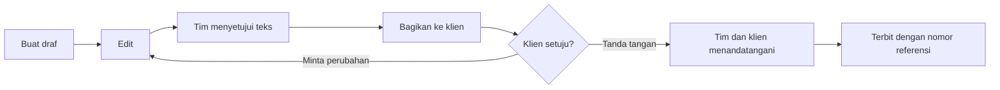

Empat dokumen dibuat dari catatan project dan ditandatangani oleh **dua pihak**: **Proposal**, **Perjanjian**, **Serah terima**, dan **Perjanjian pemeliharaan**. Dokumen baru **terbit dengan nomor referensi hanya setelah tim dan klien sama-sama menandatangani versi yang sama**. Sebelum itu dokumen masih draf yang bisa diedit.

## Langkah 1. Buat draf

Buka **Dokumen** di project, lalu pilih salah satu tombol di bagian **Buat dokumen bisnis**. Isinya disusun dari lingkup, jadwal, milestone, klien, dan nilai project. Bagian yang datanya belum ada ditandai `[PLACEHOLDER]` atau `[JANGKA WAKTU]` supaya Anda melengkapinya. Draf ini bukan nasihat hukum: minta peninjauan hukum sebelum ditandatangani.

## Langkah 2. Edit

Pilih **Ubah** untuk melengkapi teks, lalu **Simpan**. Setiap simpan menjadi satu versi. Membuat ulang draf dari data project juga menyimpan versi lama di riwayat.

Mengubah teks **menghapus tanda tangan** yang sudah ada, dan dokumen kembali menunggu persetujuan. Dengan begitu tidak ada pihak yang menandatangani kata-kata yang belum dilihatnya.

## Langkah 3. Setujui teksnya

Di bawah teks ada panel **Persetujuan dan tanda tangan** yang menunjukkan empat langkah: teks disetujui tim, tanda tangan tim, tanda tangan klien, dan terbit dengan nomor referensi. Tekan **Setujui** di bawah teks.

## Langkah 4. Bagikan ke klien dan tanda tangani

Setelah disetujui, panel menampilkan dua tombol:

- **Bagikan ke klien**: klien hanya bisa menandatangani apa yang bisa dibacanya, jadi bagikan dulu.
- **Tanda tangani sebagai tim**: tanda tangan tim, dicatat dengan nama dan waktunya. Hanya owner atau admin project yang bisa menandatangani.

Setelah tim menandatangani, panel menampilkan siapa dan kapan, dan menunggu klien.

## Langkah 5. Klien menandatangani, dokumen terbit

Klien membuka dokumen di portal. Ia bisa **menandatangani**, atau **meminta perubahan** dengan catatan. Panduan klien menjelaskan sisi itu.

- **Kalau klien menandatangani**, dokumen langsung **terbit**: statusnya menjadi ditandatangani, nomor referensi dibuat (misalnya `AGR-2026-001`), dan dokumen terkunci. Urutan tanda tangan tidak penting: tim dulu atau klien dulu, hasilnya sama.
- **Kalau klien meminta perubahan**, dokumen kembali ke tahap review, hilang dari portal, dan semua tanda tangan dihapus. Tim mendapat notifikasi dengan catatan klien. Edit, setujui, bagikan, dan tanda tangani lagi.

## Nomor referensi

Format nomornya `KODE-TAHUN-URUTAN`, dengan urutan yang berjalan terpisah untuk tiap jenis dokumen, organisasi, dan tahun:

- Proposal: `PRP-2026-001`
- Perjanjian: `AGR-2026-001`
- Serah terima: `HND-2026-001`
- Perjanjian pemeliharaan: `MNT-2026-001`

Nomor hanya dibuat saat kedua pihak sudah menandatangani. Dokumen yang masih draf atau menunggu tanda tangan tidak punya nomor.

## Yang perlu diingat

- Dokumen yang sudah terbit **tidak bisa diedit atau dibuat ulang**. Untuk perubahan, buat dokumen baru atau arsipkan yang lama.
- Tidak ada tombol "tandai ditandatangani" untuk keempat dokumen ini: tanda tangan selalu dari masing-masing pihak.
- Setiap tanda tangan mencatat nama penanda tangan dan hash teks yang ditandatangani, sehingga bisa dicocokkan dengan versinya.
- Dokumen lain (PRD, plan, dokumen biasa) tetap memakai status biasa tanpa tanda tangan dua pihak.
