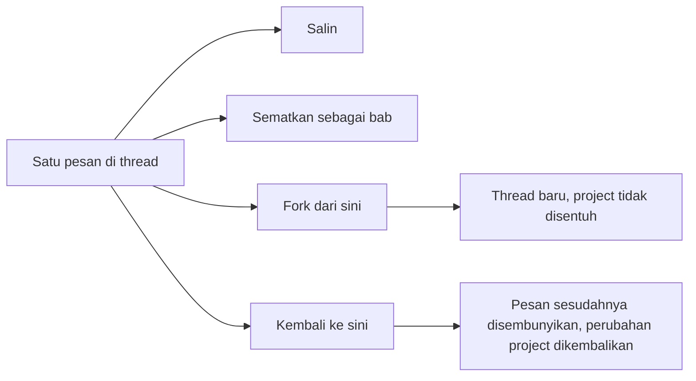

Chat Saqina adalah tempat Anda bertanya dan memberi tahu asisten apa yang harus diubah. Setiap pesan bisa dipakai ulang, diberi penanda, dicabangkan, atau ditarik kembali. Thread **bersifat pribadi**: tidak ada anggota tim lain yang melihatnya.

## Aksi pesan

Arahkan kursor ke pesan, atau tekan Tab ke pesan itu, lalu deretan tombol ikon muncul di bawahnya; arahkan kursor atau fokus ke ikon untuk melihat namanya. Di ponsel deretan ini selalu terlihat. Setiap pesan juga menampilkan **waktunya** dalam zona waktu Anda: jam saja untuk hari ini, tanggal dan jam untuk hari lain. Arahkan kursor ke waktu untuk melihat tanggal lengkap dan sudah berapa lama.

- **Salin** (dua lembar) menaruh teks pesan di clipboard. Ikonnya berubah menjadi tanda centang sesaat.
- **Sematkan sebagai bab** (penanda) dan **Fork dari sini** (cabang) dijelaskan di bawah.
- **Kembali ke sini** (panah berlawanan arah jarum jam) tidak ada di pesan terakhir, karena tidak ada yang datang sesudahnya. Aksi ini butuh izin mengubah project, jadi tidak terlihat oleh viewer.

Aksi hanya muncul di pesan yang sudah tersimpan, jadi disembunyikan selagi balasan masih ditulis.

## Menyematkan pesan sebagai bab

Pilih ikon penanda, **Sematkan sebagai bab**, beri nama (kata-kata pertama pesan disarankan) lalu tekan **Simpan**. Penanda dengan nama itu muncul di samping pesan. Daftar **Bab** di header chat langsung melompat ke pesan tersebut, dan memuat pesan lama lebih dulu bila babnya jauh di belakang. Penanda pada pesan yang disematkan terisi penuh: pilih lagi, **Lepas bab**, untuk menghapus bab.

## Fork dari sini

**Fork dari sini** menyalin thread sampai dan termasuk pesan itu ke **thread baru** lalu membukanya. Gunakan untuk mencoba arah lain tanpa menyentuh yang asli. Fork hanya berisi riwayat: usulan yang menunggu persetujuan dan agent run tetap di thread asli, dan tidak ada yang berubah di project. Fork menampilkan **Fork dari** dengan tautan kembali.

## Kembali ke sini

**Kembali ke sini** membawa thread kembali ke sebuah pesan **dan** mengembalikan apa yang diubah asisten di project sesudahnya. Dialog lebih dulu menunjukkan apa yang akan terjadi: berapa pesan disembunyikan, perubahan apa yang dikembalikan, dan usulan yang menunggu tinjauan, yang akan dibatalkan.

Yang dikembalikan:

| Perubahan oleh asisten | Saat Anda kembali |
|---|---|
| Task atau kebutuhan yang dibuatnya | Dihapus |
| Task atau kebutuhan yang diubahnya | Dikembalikan seperti semula |
| Bagian yang ditambahkan ke PRD, atau dokumen yang ditulis ulang | Teks sebelumnya kembali sebagai versi baru |

Kembali itu **semua atau tidak sama sekali**. Jika ada perubahan sesudah pesan itu yang tidak bisa dikembalikan, tidak ada yang diubah dan dialog menyebut apa yang menghalangi:

- Hal yang sudah sampai ke orang atau sistem lain: invoice, jadwal pembayaran, pengingat client, serah terima agen, eksekusi tool, dan penugasan agen.
- Catatan buatan asisten yang tidak bisa dihapus dengan bersih: memori, keputusan, item cakupan, permintaan perubahan, dokumen yang dibuat, dan task yang dihapus.
- Task, kebutuhan, atau dokumen yang **diubah seseorang sesudah** asisten mengubahnya. Saqina tidak pernah menimpa perubahan Anda.

Saat kembali terhalang, pilih **Fork dari sini saja**: fork tidak pernah menyentuh project. Pesan yang dikembalikan disembunyikan, bukan dihapus, dan tindakannya tercatat di audit trail.

## Melihat siapa yang sudah membaca pesan

Di bawah pesan Anda tampil **Dibaca Saqina** setelah asisten mengambilnya. Saat agen terhubung membaca thread, **Dibaca** dan nama agen muncul di bawah setiap pesan yang sudah diterimanya. Pesan yang ditulis setelah bacaan terakhirnya tidak diberi tanda.

## Mengizinkan agen terhubung membaca thread

Agen yang terhubung ke project lewat MCP tidak bisa melihat chat apa pun secara default. Nyalakan **Izinkan agen terhubung membaca chat ini** pada satu thread untuk membukanya. Agen lalu mendaftar thread yang dibagikan dengan `list_conversations` dan membaca pesan terbaru dengan `read_conversation`. Agen hanya melihat thread yang Anda buka, tidak pernah pesan yang sudah dikembalikan, dan setiap bacaan dicatat agar tim bisa melihatnya. Matikan saklar untuk menutup thread lagi.

## Perlu diketahui

- Penyematan, fork, dan kembali hanya berlaku untuk thread Anda sendiri.
- Kembali yang memulihkan dokumen bisa mendorong teks lama ke GitHub bila sinkronisasi dokumen aktif.
- Saran memori yang sudah diambil dari pesan tersembunyi tetap menunggu tinjauan. Anda memutuskannya seperti biasa.
