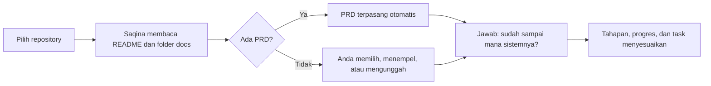

Gunakan impor kalau sistem Anda **sudah punya repository di GitHub**, mungkin sudah berjalan, sedang di-review, atau masih dibangun. Saqina membaca README dan isi folder dokumentasi, lalu menyiapkan workspace tanpa Anda mengisi interview dari nol. GitHub tetap menjadi sumber dokumen: Saqina hanya membaca dan tidak pernah menulis ke repository Anda.

## Sebelum mulai

- Nama repository di GitHub, misalnya `acme/restaurant-pos`, atau URL-nya.
- Repository **publik** tidak butuh apa-apa lagi. Repository **privat** butuh akun GitHub yang dihubungkan, atau token akses baca.
- Dokumen yang ingin dibaca client sebaiknya ada di satu folder, biasanya `docs`.

## Langkah 1. Buka Proyek baru

Dari dashboard, pilih **Proyek baru**. Halaman pertama menawarkan dua cara memulai.

## Langkah 2. Pilih tab Impor dari GitHub

Tab ini menjelaskan apa yang dibaca Saqina. Anda bisa menekan **Hubungkan dengan GitHub** untuk memilih repository dari daftar akun Anda, termasuk yang privat, tanpa menyalin token. Anda juga bisa mengetik nama repository langsung.

## Langkah 3. Isi opsi impor

Di bawah kolom repository ada tiga isian dan satu pilihan.

- **Token akses** hanya untuk repository privat. Buat token fine-grained dengan akses baca ke Contents. Token disimpan terenkripsi dan menghubungkan repository ke project.
- **Folder dokumentasi** bersifat opsional. Kosongkan untuk memakai `docs`. Semua isi folder ini dibaca (sampai 200 file dan 6 tingkat), ditampilkan di Saqina, dan bisa dibaca client. Teks yang tampak seperti rahasia, misalnya kunci akses, tetap diimpor tetapi tidak dibagikan ke client.
- **Izinkan AI membaca dokumen** mati secara default. Kalau dimatikan, Saqina memakai aturan sederhana dan tidak ada data yang keluar dari server.

Tekan **Impor dan tinjau**.

Selama membaca, tombol berubah menjadi **Membaca repository…**. Repository publik tanpa token dibatasi GitHub sekitar 60 permintaan per jam, jadi jangan mengulang impor berkali-kali dalam waktu singkat.

## Langkah 4. Jawab: sudah sampai mana sistemnya?

Setelah impor selesai Anda langsung masuk ke halaman **Progres**. Saqina sengaja **tidak** menganggap project ini baru mulai dibangun, karena sistem yang diimpor bisa saja sudah berjalan. Jawab tiga pertanyaan:

- Apakah sistem sudah selesai di-build?
- Apakah sistem sudah di-review?
- Apakah sistem sudah di-deploy?

Sampai ada jawaban, beranda project menampilkan langkah berikutnya **Jawab sudah sampai mana sistemnya**, dan tahap Build, Review, dan Deploy belum menyala.

Setiap pertanyaan dijawab sendiri-sendiri: mengubah satu jawaban tidak pernah mengubah jawaban lain. Kalau jawabannya bertentangan, misalnya review **Ya** sementara build **Belum**, halaman menampilkan peringatan dan langkah berikutnya project meminta Anda memperbaikinya.

Kalau project sudah punya task, Saqina menawarkan untuk menyesuaikan task dengan jawaban Anda:

- build **Ya**: task yang masih terbuka dipindah ke status review,
- review **Ya**: semua task yang belum selesai menjadi selesai.

Pilihannya **Batal**, **Jawab saja**, atau **Jawab dan sesuaikan task**. Task hanya bergerak maju dan tidak pernah dibuka kembali, dan setiap task tetap bisa Anda ubah sendiri sesudahnya. Kalau repository tidak punya daftar task, tidak ada task yang dibuat otomatis.

Stepper di beranda dan langkah berikutnya ikut berubah: setelah build dijawab **Ya**, tahap Review yang aktif.

## Langkah 5. Pasang PRD

Saqina mencari PRD di seluruh folder dokumentasi, termasuk subfolder. Nama seperti `prd.md`, `project-prd.md`, atau `01-prd.md` dikenali. Kalau ketemu, PRD langsung terpasang dan terus mengikuti GitHub.

Kalau tidak ketemu, halaman **PRD** bertanya dokumen mana yang PRD. Ada dua cara.

**Dari repository.** Pilih salah satu file yang sudah dibaca. File itu menjadi PRD dan tetap mengikuti GitHub.

**Tempel atau unggah.** Unggah file `.md`, `.markdown`, atau `.txt` (maksimal 200 KB), atau tempel teksnya. Isi file masuk ke kotak teks lebih dulu supaya Anda bisa memeriksanya sebelum menyimpan.

PRD yang sudah ada tidak pernah ditimpa. Kalau PRD memang belum ada, biarkan kosong: Saqina tidak membuat PRD sendiri untuk project hasil impor.

Semua dokumen Markdown mendukung diagram **Mermaid**. Tulis blok kode dengan bahasa `mermaid` dan diagramnya tampil di pratinjau dan di portal client. Kalau teks diagram tidak valid, sumbernya ditampilkan bersama pesan.

## Langkah 6. Periksa Dokumen

Halaman **Dokumen** memuat semua file yang dibaca.

- File di folder dokumentasi berstatus **Disetujui** dan **Dibagikan**, jadi client bisa membacanya di portal.
- File di luar folder itu, seperti README, berstatus **Draf** dan tetap internal. Anda bisa membagikannya sendiri setelah menyetujuinya.

## Bagaimana dokumen mengikuti GitHub

- **Satu arah.** Saqina hanya menarik dari GitHub dan tidak mengirim apa pun balik: tidak ada branch atau pull request.
- **Kapan menarik.** Saat halaman Dokumen dibuka dan tarikan terakhir lebih dari 10 menit lalu, sebelum menyimpan edit, dan sekali sehari lewat cron.
- **File baru** di folder dokumentasi otomatis muncul sebagai dokumen baru, dan ikut terlihat oleh client.
- **Kalau dua sisi berubah**, yang paling baru menang. Kalau GitHub lebih baru, teksnya dipakai dan teks Saqina tetap ada di riwayat versi. Kalau teks Saqina lebih baru, teks itu dipertahankan.
- **Jawaban build, review, deploy** tidak otomatis kedaluwarsa karena perubahan dari GitHub. Kalau task atau milestone berubah setelah jawaban, jawabannya diberi tanda untuk dikonfirmasi ulang.

## Masalah umum

- **Repository tidak ditemukan.** Periksa penulisan `pemilik/nama`. Untuk repository privat, hubungkan GitHub atau isi token.
- **GitHub membatasi permintaan.** Tunggu beberapa menit, atau hubungkan akun GitHub supaya batasnya lebih longgar.
- **PRD tidak terdeteksi.** Pakai kartu pertanyaan PRD di halaman PRD untuk memilih, menempel, atau mengunggah.
- **Dokumen tidak muncul untuk client.** Hanya dokumen berstatus Disetujui yang bisa dibagikan, dan hanya file di folder dokumentasi yang dibagikan otomatis.
- **Folder dokumentasi tidak bernama `docs`.** Isi nama foldernya di langkah 3, misalnya `documentation/product`.
