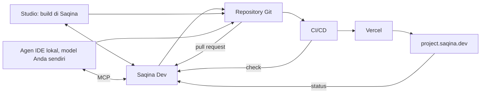

Panduan ini membahas jalan dari PRD yang sudah disepakati sampai pekerjaan berjalan, serta pengaturan platform yang dipakai asisten dan agen di semua project.

## Generate PRD

Di halaman **PRD**, tekan **Generate PRD**. Form-nya punya satu isian per bagian, diisi dari PRD saat ini atau, kalau belum ada, dari interview project.

- **Enhance** membuat satu bagian lebih spesifik. Kalau model AI sudah disiapkan, model menulis ulang bagian itu mengikuti skill Superpowers *brainstorming*; kalau belum, Saqina merapikan teksnya dengan aturan dan tidak menambah isi baru.
- **Enhance semua bagian** memproses semuanya satu per satu.
- **Simpan sebagai PRD** menulis versi baru. Tanda tangan dihapus dan PRD kembali ke draft, jadi disetujui lagi sebelum agen bekerja berdasarkan PRD itu.

Setelah interview, kalau model sudah disiapkan, Saqina juga menyempurnakan PRD dan plan yang dibuat dengan skill Superpowers dan memberi nama project dari plan-nya. Dokumen yang disempurnakan menunggu di **Persetujuan**; tidak ada yang berubah sampai Anda setujui. Nama yang Anda ketik sendiri tidak pernah diganti.

## Kerjakan sekarang

Begitu PRD atau plan **disetujui**, atau perjanjian sudah ditandatangani kedua pihak, dokumen menampilkan **Kerjakan sekarang**.

- Kalau project dibangun di Saqina, tombol ini langsung memulai **Build**, sama seperti mode Build di chat. Studio terbuka di atasnya: chat menampilkan kartu yang hidup dan tab Agen menampilkan tiap agen bekerja, tanpa reload. Agen melakukan commit ke branch kerja; tidak ada yang masuk ke branch utama tanpa Anda. Lihat [Plan dan Build dengan agen](/dashboard/docs/agents-and-builds).
- Kalau project dibangun di luar Saqina, tombol ini hanya membuka Studio.
- Kalau project sudah punya build terbuka sebanyak yang bisa dijalankan, tombol membuka Studio tempat build yang berjalan. Kalau tidak ada yang bisa dimulai, misalnya belum ada model AI, halaman memberi tahu sebabnya.

## Studio

Studio menempatkan chat di samping area kerja.

- **Plan** menampilkan rencana eksekusi yang sedang berjalan, atau milestone dan task proyek. Saat Anda meminta plan lewat chat, area kerja pindah ke tab ini.
- **Agen** menampilkan setiap agen yang bekerja, apa yang mereka sampaikan satu sama lain dan apa yang terjadi, serta tautan ke run sebelumnya.
- **Kode** menampilkan apa yang diubah agen di branch kerjanya (dengan diff) dan, di bawahnya, repository (hanya baca). **Git** menampilkan branch kerja, commit, dan CI-nya, serta pull request proyek. **Preview** menampilkan preview branch kerja dan situs yang sudah tayang. **Publish** menampilkan tahap dari kode sampai tayang, dan menayangkan situsnya.

Di bawah kotak pesan, **Chat**, **Plan**, dan **Build** menentukan apa yang dilakukan Saqina dengan pesan Anda. Plan dan Build menjalankan tim agen: lihat [Plan dan Build dengan agen](/dashboard/docs/agents-and-builds).

Kalau asisten kurang yakin maksud permintaan yang mengubah data, ia bertanya dulu di chat dan tidak melakukan apa pun sampai Anda menjawab **Ya, lanjutkan**.

## File dan konteks di chat

Di chat Studio (dan halaman Saqina):

- **Lampirkan** (ikon klip) menambahkan file: gambar, PDF, atau file teks seperti Markdown, CSV atau kode, maksimal 5 MB dan 5 file per pesan. File juga bisa diseret ke chat, atau gambar ditempel langsung. File teks dibaca ke dalam percakapan; gambar dan PDF hanya terbaca bila model AI project bisa melihatnya, dan kalau tidak, balasannya mengatakan begitu.
- **+ Konteks** memilih skill dan konektor untuk pesan-pesan berikutnya. Skill yang dipilih selalu memandu jawaban. Dengan konektor terpilih, Saqina memakai tool-nya untuk menjawab dan menampilkan hasil dari tool itu. Tool yang bisa mengubah sesuatu di luar Saqina menunggu persetujuan Anda lebih dulu.
- **Kelola konektor** di menu yang sama membuka pengaturan konektor, untuk owner platform dan admin project.

File disimpan di penyimpanan privat dan hanya bisa dibuka anggota project.

## Skill dan konektor (owner platform)

Di **AI & Model**:

- **Skill**: metode kerja berformat SKILL.md yang dipakai di semua project. Superpowers dan antislop sudah terpasang bawaan: Superpowers membentuk PRD dan rencana, antislop (inti, copywriting, UI, aksesibilitas, layout mobile, komentar kode) menjaga teks, antarmuka, dan kode bebas dari pola AI yang generik dan selalu dipakai saat menulis. Pasang yang lain dengan menempel SKILL.md atau menautkan ke GitHub, lalu pilih untuk apa skill itu dipakai. Saqina hanya membaca teks skill; tidak ada yang dijalankan dari skill.
- **Konektor**: server MCP yang dihubungkan sekali untuk semua project. Firecrawl, Exa dan Context7 cukup satu klik ditambah API key; server lain bisa ditambahkan sebagai MCP kustom. Tool yang menyatakan tidak mengubah apa pun langsung menyala; sisanya menunggu keputusan Anda. Key disimpan terenkripsi dan tidak pernah ditampilkan lagi.

## Pakai CLI yang sudah login di server (owner platform)

Sebagai pengganti API key, Anda bisa memakai Claude Code, Codex, atau OpenCode yang sudah login di mesin yang menjalankan Saqina. Di **AI & Model**, **Provider**, bagian **CLI lokal** memuat ketiganya, apakah masing-masing terpasang di server ini, dan versinya.

1. Login ke CLI di server, sebagai user yang menjalankan Saqina. Halaman menampilkan perintahnya, misalnya `claude auth login`.
2. Tekan **Hubungkan dan uji**. Saqina mengajukan pertanyaan singkat ke CLI. Begitu CLI menjawab, ia muncul di daftar provider di bawah beserta modelnya, dan Anda bisa menjadikannya model default atau memetakannya ke peran agen di **Pemetaan agent**.
3. Untuk berhenti memakainya, **Putuskan** atau **Nonaktifkan** di daftar provider. Menekan **Hubungkan dan uji** lagi mengembalikannya.

Perlu diketahui:

- Hanya owner platform yang melihat dan mengelola ini, dan setiap perubahan tercatat di log audit.
- Fitur ini **mati** sampai orang yang menjalankan server mengatur `ALLOW_LOCAL_CLI=1`. Halaman memberi tahu selama masih mati.
- Hanya bekerja dengan CLI yang terpasang di mesin yang sama dengan server. Di Vercel, CLI tampil tidak terpasang.
- Saqina menjalankan CLI di folder sementara yang kosong, tanpa tool, dan tanpa key atau alamat database miliknya. CLI menjawab; ia tidak bisa membaca atau mengubah berkas.
- CLI memakai login user server, jadi semua yang memakai provider ini berbagi login itu.
- CLI mengirim jawabannya setelah selesai, jadi teks tidak muncul kata demi kata.

## Database dan layanan masuk untuk aplikasi Anda

Di Studio, tab **Publish**, tambahkan database atau layanan masuk yang dipakai aplikasi: Neon, Supabase, Clerk, Postgres, atau variabel Anda sendiri. Semuanya selalu akun milik Anda: Saqina tidak menyediakan database, hanya menyimpan kunci Anda terenkripsi untuk project ini dan mengirimkannya ke deployment.

Setiap variabel punya tiga nilai:

| Nilai | Dipakai di | Aturan |
|---|---|---|
| **Live** | Situs yang dipublikasikan | Database asli dan kunci live Anda |
| **Preview** | Preview Saqina untuk setiap versi | Database sendiri (branch Neon, project Supabase kedua) dan kunci uji Clerk |
| **Lokal** | Komputer developer sendiri | Opsional; kosong berarti memakai nilai Preview. Tidak pernah database live atau kunci Clerk live |

Selama Live dan Preview belum terisi dan belum terpisah, Publish dan Preview menjelaskan apa yang kurang dan menunggu. Kunci tidak pernah ditampilkan lagi; kosongkan kolom untuk tetap memakai yang lama.

### Env yang sama di Saqina dan di IDE lokal

Aplikasi membaca nama variabel yang sama di mana pun; hanya nilainya yang berbeda.

- **Build in Saqina:** Saqina mengirim nilai Live dan Preview ke deployment sebelum setiap publish, dan langsung lagi saat Anda mengubah nilai pada project yang sudah dipublikasikan. Agen hanya melihat nama variabel.
- **Di IDE lokal:** di bagian **Bekerja di IDE lokal**, unduh **.env.example** (nama saja; commit ke repository) dan, sebagai admin project, **.env.local** (nilai Lokal, atau Preview bila Lokal kosong; jangan di-commit, tidak pernah nilai live). Setiap unduhan `.env.local` dicatat di log aktivitas. Di akun Vercel Anda sendiri, `vercel env pull` memberi nilai Lokal yang sama.
- **Tetap selaras:** Saqina membaca `.env.example` dari repository. Nama di sana yang belum diatur di Saqina tampil sebagai peringatan, karena preview akan gagal tanpanya. Nama yang sudah diatur di Saqina tetapi belum ada di `.env.example` ditampilkan supaya Anda bisa menambahkannya.
- **AGENTS.md** memberi tahu agen IDE aturan yang sama: baca `process.env`, tambahkan nama baru ke `.env.example`, minta owner mengisi nilainya di Saqina.

## Model AI Anda sendiri di chat

Di bawah kotak chat, tombol model menunjukkan siapa yang menjawab: **Default platform**, atau salah satu model Anda sendiri.

1. Buka dan pilih **Tambah gateway saya**.
2. Pilih penyedia (OpenAI, Anthropic, Google Gemini, atau endpoint yang kompatibel dengan OpenAI), beri nama, lalu tempel API key Anda. Tulis id model, atau kosongkan untuk menambah model chat yang bisa dilihat kunci Anda.
3. **Periksa dan tambah** menguji kunci ke penyedia lebih dulu; kunci yang ditolak tidak pernah disimpan.
4. Pilih model Anda. Pilihan diingat di browser ini.

Gateway ini hanya milik Anda: anggota project lain maupun owner platform tidak bisa melihat, memakai, atau menghapusnya, dan kuncinya tidak pernah ditampilkan lagi. Gateway hanya berfungsi selama owner platform mengizinkan penyedia luar. Saat menjawab dengan model Anda, pesan Anda, teks project yang dibutuhkan, dan file Anda dikirim ke penyedia itu; kalau penyedia tidak bisa menjawab, Saqina menjawab dari data project tanpa model, bukan beralih ke penyedia lain. Pakai API key: masuk dengan langganan ChatGPT atau Claude tidak ditawarkan.

## Cara semuanya tetap sinkron

Saqina adalah pusatnya. Entah pekerjaan dilakukan di Studio atau di IDE Anda sendiri, hasilnya masuk ke repository Git yang sama, dan apa yang terjadi di sana kembali ke Saqina.

**Git.** Menghubungkan repository GitHub memasang webhook secara otomatis. Kalau token Anda tidak punya hak admin di repository, **Studio > Git** menampilkan URL dan secret untuk ditambahkan sendiri di GitHub. Sesudah itu branch, pull request, check dan deployment muncul di tab **Git**.

**Referensi task.** Setiap task punya referensi pendek seperti `T-1a2b3c4d`. Tulis di nama branch (`saqina/T-1a2b3c4d-checkout`) atau tulis `Saqina-Task: T-1a2b3c4d` di pull request. Saqina menautkan branch dan pull request ke task. Pull request yang dibuka memindahkan task ke review; saat Anda menggabungkannya di GitHub, task selesai. Pull request yang ditutup tanpa digabung tidak mengubah apa pun.

**Jawaban delivery.** Di **Progress**, check hijau di branch utama, pull request yang sudah digabung dan deployment production yang berhasil muncul sebagai saran dengan tombol **Konfirmasi: Ya**. Anda tetap yang menjawab; tidak ada yang diisi otomatis.

**Publish.** Di **Studio > Publish**, **Publish** membuat project Vercel dari repository Anda dan menempatkannya di `<project>.saqina.dev`. Secara default ini memakai Vercel Saqina. Anda juga bisa memilih **Vercel saya sendiri** dan menempel token Vercel Anda (serta tim dan domain Anda sendiri). Token disimpan terenkripsi, hanya untuk project ini. Aplikasi GitHub milik Vercel harus bisa melihat repository. **Preview** menampilkan situs yang sudah tayang.

**IDE Anda sendiri.** Di **Pengaturan > Akses agen**, buat token, pilih izinnya (tambahkan *Mengambil task dan melaporkan hasilnya* dan *Memakai tool konektor project* untuk sinkron penuh), salin snippet untuk Claude Code, Cursor, Codex atau Kiro, dan unduh **AGENTS.md** ke repository Anda. Agen kemudian melihat daftar task, mengambil satu, bekerja di branch dengan referensi task, membuka pull request dan melapor `review` atau `blocked`. Agen memakai model Anda sendiri, dan mendapat skill dan konektor yang sama dengan agen Saqina. Hanya Anda yang menandai task selesai, dengan menggabungkan.

## Model agen

Di halaman **Agent**, **Atur** memungkinkan Anda memilih model dari yang sudah disiapkan di AI & Model, atau **Otomatis**, yang mengikuti default project dan platform. Tidak ada isian untuk mengetik nama model.
